  

  <code>building automations people actually use · self-hosting everything · the homelab never sleeps</code>

  
  
  
  
  
   
  
  
  
  
  
  

  

  <a href="https://github.com/giuseppe99barchetta/SuggestArr"><code>SuggestArr</code></a> ·
  <a href="https://github.com/giuseppe99barchetta/home_maintenance"><code>home_maintenance</code></a> ·
  <a href="https://github.com/giuseppe99barchetta/FordConnect-HA"><code>FordConnect-HA</code></a> ·
  <a href="https://github.com/giuseppe99barchetta/MediaFlowrr"><code>MediaFlowrr</code></a>
  &nbsp;
  

  

  

  

  
  

<code>$ exit</code> · terminals re-rendered daily by <a href="./.github/workflows/profile.yml">GitHub Actions</a>

